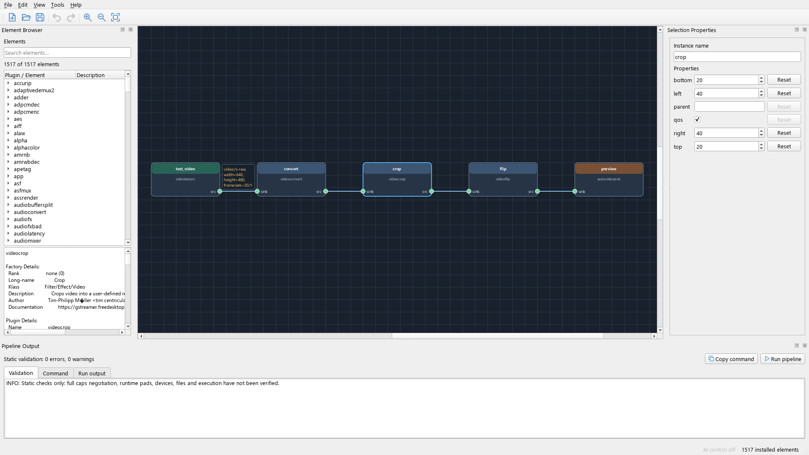

# GStreamer Pipeline Creator

A graphical editor for GStreamer pipelines. Add elements, connect their
pads, and check the pipeline for errors. Generate a `gst-launch-1.0` command
to run it.



## Project layout

- `gst_creator/`: application package and source code.
- `tests/`: unit tests, integration tests, and fixtures.
- `docs/`: MCP setup and usage documentation.
- `scripts/`: utility scripts for generating application assets.

## Running the application

### Requirements

Install the GStreamer command-line tools and the plugins you want to use.
Follow the installation guide for your platform:
[Installing GStreamer](https://gstreamer.freedesktop.org/documentation/installing/).
Make sure `gst-inspect-1.0` and `gst-launch-1.0` are available on `PATH`.
No Python GStreamer bindings are required.

### Using the Windows executable

If you have a built executable, open `gst-creator.exe`. Python and the
application's Python dependencies are bundled with it; GStreamer must still
be installed separately.

To build the executable yourself, see
[Building a Windows executable](#building-a-windows-executable).

### Running from source

Install Python 3.11 or newer, then create a virtual environment and install
the project dependencies from the repository root. These include PySide6
for the Qt interface and the MCP SDK for AI control. The app has been tested
with Python 3.13.

On Windows, run these commands in PowerShell:

```powershell
python -m venv .venv
.\.venv\Scripts\python.exe -m pip install -e .
.\.venv\Scripts\python.exe -m gst_creator
```

On Linux or macOS:

```bash
python3 -m venv .venv
.venv/bin/python -m pip install -e .
.venv/bin/python -m gst_creator
```

Once the environment is set up, use only the last command to start the app.

### Discovering and refreshing elements

On first startup, the app discovers the installed GStreamer elements. The
message above the browser shows the discovery progress, then the number of
available elements or an error if discovery fails.

Later startups load the saved discovery cache. Missing or invalid caches
are rebuilt automatically. After installing, removing, or updating plugins,
choose **Tools > Rediscover Elements** to refresh the list. If the refresh
fails, the previous list and cache are kept. Elements already on the canvas
keep their existing metadata; add them again to use updated definitions.

Discovery uses the output of `gst-inspect-1.0 --print-all`. See the
[GStreamer tools documentation](https://gstreamer.freedesktop.org/documentation/tools/gst-inspect.html).

## How to use the app

### Adding and connecting elements

Use the **Element Browser** to find installed elements. They are grouped by
plugin, and you can search by element name, plugin, category, or description.
Select an element to read its details, then double-click it to add it to the
canvas.

Drag the blocks to arrange them. To connect two elements, drag an output pad
to an input pad. Select a block to edit its instance name and properties in
**Selection Properties**. Use **Reset** beside a property to restore its
default value.

### Navigating the canvas

Scroll the mouse wheel to zoom. Hold the middle mouse button and drag to
pan. Use **View > Fit Elements** to bring the whole pipeline into view, or
**View > Actual Size** to reset the zoom.

Drag a selection rectangle over the canvas to select several blocks.

### Removing elements and connections

Select a block or connection and press **Delete**, or choose
**Edit > Delete selection**. Deleting a block also removes its connections.
To disconnect two elements without removing either block, select the
connection line and delete it.

### Setting connection caps

Select a connection to edit its caps in **Selection Properties**. Caps
restrict the formats that can pass through the connection. For example:

```text
video/x-raw,width=1280,height=720,framerate=30/1
```

Caps appear above the connection and are saved with the project. Clear the
field or use **Reset** to remove the restriction. Use conversion elements
when you need to change formats; caps alone do not convert data.

### Duplicating elements and undoing changes

Select one or more blocks and choose **Edit > Duplicate selection**, or
press **Ctrl+D**. The copies retain their properties and the connections
between them. Connections to elements outside the selection are not copied.

Use **Edit > Undo** and **Edit > Redo** to undo or reapply changes. The app
keeps up to 100 undo steps, including moves, property edits, connections,
and duplication. Saving keeps the history; creating or opening a project
clears it.

### Saving and opening projects

Use **File > New**, **Open**, **Save**, and **Save As** to manage projects.
Projects use the `.gstproj` extension and store the elements, properties,
positions, connections, and caps.

Wait for element discovery to finish before opening a project. The required
GStreamer elements must be installed on the current system. If an element
or pad is missing, the app reports the problem and keeps the current project
open.

An asterisk in the window title marks unsaved changes. The app asks whether
to save them before closing or replacing the project.

### Checking the pipeline

The **Pipeline Output** panel updates as you edit. If it is hidden, reopen
it through **View > Pipeline Output**. The **Validation** tab lists errors
and warnings. Double-click an issue to select the affected block or
connection.

Checks cover element names, properties, pad connections, and incompatible
media types. Unconnected pads and disconnected elements produce warnings.
These checks do not verify devices, files, or full format negotiation;
GStreamer checks those when the pipeline runs.

### Generating a command

Open the **Command** tab in **Pipeline Output** to see the generated
`gst-launch-1.0` command. **Copy command** becomes available when there are
no validation errors. The copied command is formatted for POSIX shells such
as Bash.

Connection caps are included in the command. Elements whose pad names are
only known at runtime may prevent command generation.

For command syntax, see the official
[gst-launch documentation](https://gstreamer.freedesktop.org/documentation/tools/gst-launch.html).

### Running and stopping a pipeline

Click **Run pipeline** in **Pipeline Output** to start the pipeline. Messages
and errors appear in the **Run output** tab. Click **Stop pipeline** to stop
it. Closing the app also stops the pipeline.

Edits to the canvas do not change a running pipeline. Stop it and run it
again to apply your changes. Stopping may force termination, so recorded
files may not be finalized.

## AI control with Codex

Describe a pipeline to Codex and let it create the graph in the running
editor. Follow-up requests can change properties, insert elements, connect
pads, and arrange the canvas. Each edit batch is one undoable change.

The app enables local AI control at startup. Toggle it through
**Tools > Enable AI Control**. The MCP server runs inside the editor at
`http://127.0.0.1:8765/mcp`. See [MCP setup and usage](docs/mcp.md) to
connect Codex and try example prompts.

## Building a Windows executable

On Windows, run these commands from the repository root after setting up
the project virtual environment:

```powershell
.\.venv\Scripts\python.exe -m pip install "PyInstaller>=6.5,<7"
.\.venv\Scripts\python.exe -m PyInstaller gst-creator.spec
```

The executable is created at `dist/gst-creator.exe`.

## Running tests

Run the test suite from the repository root:

On Windows, in PowerShell:

```powershell
$env:QT_QPA_PLATFORM = 'offscreen'
.\.venv\Scripts\python.exe -B -m unittest discover -s tests
```

On Linux or macOS:

```bash
QT_QPA_PLATFORM=offscreen .venv/bin/python -B -m unittest discover -s tests
```

The command-generation integration tests use finite test pipelines and
require `gst-launch-1.0`; they skip when the tool is unavailable.
